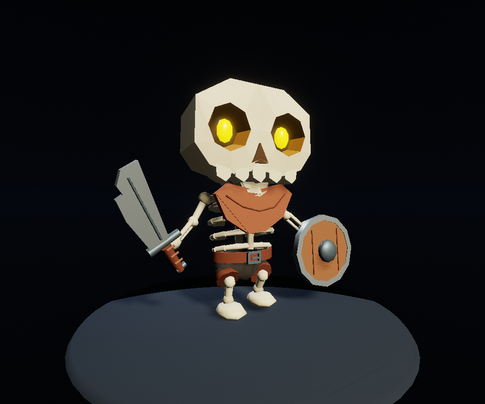

# Procedural Skeleton: an AdaScript rigging study

This technical example authors a stylized skeleton's geometry, 23 joints, vertex
weights and walk clip in one interpreted AdaScript recipe. It is intentionally
outside the public examples catalog; it does not appear in Studio recommendations.



## Open the project

Open this directory in Ada Studio, open `Assets/Scenes/Walk.ascn` and press Play.
The committed `Skeleton-AdaScript.glb` already contains the rig and `Walk` clip.
The scene uses the existing native importer, animation player and GPU skinning.
Select `BindPose` instead of `Walk` on the subject's `Model3DSource` to inspect
its undeformed pose. `Showcase.ascn` retains the original static model.

The character has 7,348 vertices, 4,284 triangles, 11 materials and 306 vertices
with two nonzero joint influences. Walk lasts 1.2 seconds with 49 keys per track.
The leg IK runs while authoring keys; runtime playback evaluates a regular clip.

## Regenerate through Studio

Use a Studio build containing the procedural rig builder from
[Ada PR #205](https://github.com/AdaEngine/Ada/pull/205). Pass the full contents of
`Generators/Skeleton-Rig.ada` as `source` to `editor.model.generate`, with a fresh
`destination`, such as `Assets/Models/Skeleton-v2.glb`. The tool never overwrites
an existing asset. Validate the new file and point the scene at its asset reference.

The native builder ships precompiled in the app. The embedded compiler generates
bytecode for the VM; recipe execution needs no JIT, Swift compiler, Python, shell,
Blender or cloud 3D service. Character anatomy, weight rules and leg IK are in
AdaScript. The language agent itself may still use an external model.

`SkeletonRigRecipe.ada` holds the rig and motion rules; `Skeleton.ada` contains
static geometry generated by `author_recipe.py`. The composed `Skeleton-Rig.ada`
is self-contained and does not load those files at runtime.

Windows VM execution, buffer validation and native GPU playback have been checked.
Physical iPad execution and a complete rebuilt Studio bundle remain unverified.
The installed validation Studio predates the new generation API: it proves output
playback; the actual extended generator was exercised in the developer harness.

## Optional developer validation

These commands require a compatible local Ada engine checkout and Swift, and are
not steps performed on an iPad. From this example directory, set the engine path
explicitly; no local package dependency is committed:

```powershell
$env:ADAENGINE_ROOT = 'C:/path/to/Ada'
$env:ADAENGINE_GRAVITY_PACKAGE_PATH = 'C:/path/to/windows-compatible/gravity-lang'
python script_rig.py test
python script_rig.py generate
python check_geometry.py
python check_rig.py --asset Assets/Models/Skeleton-AdaScript.glb --output Evidence/ScriptRig/buffer-check.json
```

Use the repository's Windows-compatible Gravity override on Windows. On other
hosts, the engine's `Sources/gravity-lang` is the default dependency. The harness
copies actual production sources into an isolated package under the selected
engine's `.build-tools` directory and uses a standalone resource-scope adapter.
It does not build the full engine or Studio. After building the runner once,
`python script_rig.py run` executes it directly without invoking a compiler.

With this project open in Studio and its MCP server on port 2516:

```text
python rig_capture.py --asset Assets/Models/Skeleton-AdaScript.glb --evidence Evidence/ScriptRig --live-only
```

Captures, reports, logs, workspace state and auxiliary sampled GLBs are ignored.
The committed preview and four small GLBs are the playback assets and comparison
fixtures. The older Swift author in `NativeRig/` is a developer comparison baseline;
it is not needed to execute the AdaScript recipe. Its tests run with
`python native_rig.py test` using the same `ADAENGINE_ROOT`.

## Limits

This recipe assigns an explicit rig to known generated parts; it does not infer
anatomy or edit arbitrary imported meshes. The builder supports up to 128 joints,
two weights per vertex and linear joint translation/rotation clips. Rest-joint
rotations, scale keys, fingers, facial rigging, cloth simulation and retargeting
are not implemented here. Check actual poses visually; import and buffer checks
do not establish the absence of every self-intersection.

The original user-supplied character reference was labeled KayKit. This is a
procedural study based on that reference, not an official KayKit asset package.
